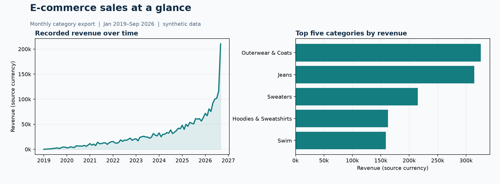

# E-commerce Sales Performance Analysis

**A simple dashboard and analysis of monthly product-category sales.** Built with Python, pandas, Streamlit, and a saved export from Google's synthetic `thelook_ecommerce` BigQuery dataset.



### At a glance

| Question | What the saved data shows |
| --- | --- |
| How much revenue is recorded? | **2,691,096.65** across 93 months and 26 categories |
| Which category leads? | **Outerwear & Coats**, with **325,754.89** (12.1% of recorded revenue) |
| What changed recently? | September 2026 revenue is **81.4%** above August; the cause is unverified |

The chart is generated from the checked-in CSV with `python generate_preview.py`.

## Explore the project

| Start here | What you will find |
| --- | --- |
| [Interactive dashboard](app.py) | Filter categories, inspect monthly revenue, and download a monthly summary |
| [Guided analysis notebook](sales_performance_analysis.ipynb) | Run the calculations step by step, with a title and explanation before each code cell |
| [Analysis functions](sales_analysis.py) | Validate the export and calculate monthly and category summaries |
| [Saved source data](ecommerce_master.csv) | The month-by-category table used throughout the project |
| [Proposed BigQuery query](monthly_category_sales.sql) | A starting point for a new export; it is not verified to reproduce the saved CSV |

## Questions answered

1. How did recorded revenue change over time?
2. Which categories contributed most to recorded revenue?
3. Which categories drove the latest month-to-month change?

## Data and metric definitions

Each source row is one **month and product category**. `revenue` is recorded sale value; `items_sold` is item count; `average_item_price` approximately equals revenue divided by items sold. `total_orders` counts orders **within a category**. Summing it across categories gives *category order occurrences*, not unique storewide orders: an order with items in two categories may be counted twice. The saved file has no order IDs, customer IDs, profit, brands, or location fields.

The data is synthetic and can change when the upstream dataset is regenerated. Results describe this saved snapshot; they do not establish causation or forecast future sales. Currency follows the source export; no conversion was performed.

## Run locally

Create a Python environment in the repository root and install the dependencies, then run:

```powershell
python -m venv .venv
.\.venv\Scripts\Activate.ps1
python -m pip install -r requirements.txt
python sales_analysis.py
streamlit run app.py
```

Open `sales_performance_analysis.ipynb` in VS Code or Jupyter and run cells from top to bottom. It reads the local CSV, so cloud credentials are unnecessary. To refresh from BigQuery, review the proposed SQL and record its run date and filters. An exact match with the historical CSV is not expected.

## Interpreting the results

The latest recorded month has a large revenue jump. Use it as a lead for further investigation, not as evidence that a particular campaign worked. In a real business, check the underlying transactions, returns, margins, inventory, and any changes to data generation before making decisions.

## Source and scope

The `thelook_ecommerce` public dataset appears in [Google Cloud's public dataset documentation](https://docs.cloud.google.com/bigquery/public-data). Google describes theLook as synthetic in its [training lab](https://partner.skills.google/focuses/80989?parent=catalog). The repository's older notebook and exports predate this documented analysis. No Power BI `.pbix` file is included; the interactive deliverable is Streamlit.

## Author

Angel John B. Escara · BS Computer Science, Data Science specialization · FEU Institute of Technology
